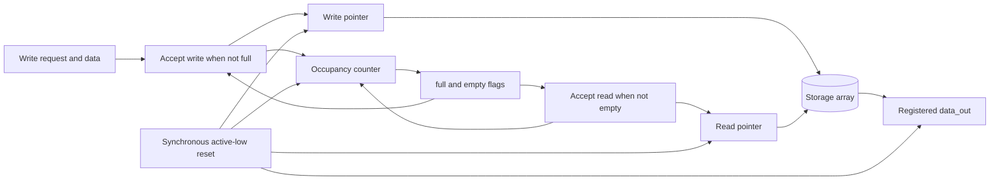

# Architecture: Synchronous FIFO

## Purpose and Scope

Define the first implementation target for a small, parameterized synchronous FIFO and the surrounding verification flow. This is a digital RTL simulation project. Simulation demonstrates modeled behavior; it does not establish that physical silicon works or meets timing, power, or reliability requirements.

## Proposed FIFO Contract

The RTL exposes a clock, synchronous active-low reset (`rst_n`), write enable/data, read enable, read data, `full`/`empty` status, and an occupancy count. `DATA_WIDTH` defaults to 8 bits and `DEPTH` defaults to 16 entries. Both parameters must be positive integers; every positive depth is supported, including depth one and non-power-of-two depths.

- Reset is sampled on the rising clock edge. When `rst_n` is low, it clears read/write pointers, occupancy, and `data_out`. Memory contents are not reset and are not observable through a legal read until written.
- `empty` is true when occupancy is zero; `full` is true when occupancy equals depth.
- A write is accepted on a rising edge only when write enable is asserted and the FIFO is not full at the start of that edge.
- A read is accepted on a rising edge only when read enable is asserted and the FIFO is not empty at the start of that edge.
- A successful read returns the oldest queued item in `data_out`; absent a successful read, `data_out` holds its previous value.
- Simultaneous read and write are supported when each operation is independently legal under the pre-edge flags. Occupancy stays unchanged when both are accepted.
- There is no fall-through/bypass behavior: a read while empty is rejected even if a write is requested on the same edge. Likewise, a write while full is rejected even if a read is requested on that edge.
- Rejected operations do not change pointers or occupancy.

These choices make boundary behavior deterministic and avoid implicit same-cycle capacity borrowing. In particular, with both enables asserted while full, the read is accepted and the write is rejected; while empty, the write is accepted and the read is rejected. `occupancy` stays in the inclusive range zero through `DEPTH`, so it cannot overflow or underflow under these acceptance rules.

## Block Diagram

## FIFO Operation

The storage array holds up to `DEPTH` words. The write pointer selects the next slot to fill, and the read pointer selects the oldest queued word. Each pointer advances only when its corresponding operation is accepted; it wraps explicitly from `DEPTH - 1` to zero, so power-of-two depth is not required. The occupancy counter increments for write-only acceptance, decrements for read-only acceptance, and stays unchanged when both or neither are accepted. `empty` is derived from occupancy zero and `full` from occupancy equal to `DEPTH`.

At each rising edge, write/read acceptance uses the status before that edge. A legal read captures the old storage word into `data_out`; a same-edge write to that location does not change the word being read because sequential assignments are nonblocking. Reset is synchronous and active-low. This behavior is digital RTL behavior for simulation and synthesis, not evidence from physical silicon.

## RTL Structure

The FIFO uses a storage array, wrapping read and write pointers, and an occupancy counter. Pointer width must support the configured depth; pointer wrap must work for non-power-of-two depths. The occupancy width must represent values from zero through depth. All state changes occur in one clocked process, with combinational status derived from occupancy.

The initial implementation should use synthesizable constructs and avoid simulator-only behavior in `rtl/`. The testbench may use assertions, tasks, and waveform dumping as supported by the selected simulator.

## Verification and Automation Boundaries

The SystemVerilog testbench checks the RTL against directed and randomized traffic using its internal queue scoreboard. Standard-library Python unit tests cover the validation runner, regression runner, report summarizers, fault-injection classification, and diagnostic analyzer; there is no separate Python FIFO reference model. The automation layer invokes real local simulator commands, captures their output and return code, and stores generated artifacts under `reports/`.

The SystemVerilog scoreboard and Python automation tests are digital verification checks, not physical measurements. Diagnostic categories are derived from report fields/messages and must not be interpreted as confirmed silicon root causes. The framework reports recorded evidence and does not infer silicon coverage, timing, or pass status from missing logs.

## Opt-In Fault Injection

`scripts/run_fault_injection.py` creates an isolated temporary copy of the RTL and flips the least-significant bit of accepted read data. It compiles that copy against the existing testbench without changing the normal RTL, testbench, or `run_validation.py` path. The known first read of `0x00` must trigger the testbench diagnostic `FAIL test=single_read_zero cycle=3 seed=1 data_out expected=0x00 actual=0x01` and a nonzero simulator return code. Compilation errors, missing tools, unrelated simulation failures, and simulations that unexpectedly return zero do not count as detection. The harness exits zero only when the intended diagnostic and nonzero simulator result are both observed; its artifacts have a separate `fault_injection_` prefix.

## Planned Data Flow

1. Validation runner compiles and runs the RTL testbench with the selected simulator.
2. Runner preserves stdout/stderr, command metadata, and simulator exit status in `reports/`.
3. Regression and diagnostic analyzers classify recorded statuses and messages, flagging unknown or incomplete evidence.
4. Markdown report generators summarize observed outcomes without fabricating metrics.

## Design Risks to Verify

- Pointer wrap and storage indexing at non-power-of-two depths.
- Correct occupancy updates for accepted read/write combinations.
- Full and empty behavior at exact boundaries and during simultaneous requests.
- Reset behavior and the first legal data transfer after reset.
- Agreement between the RTL, testbench scoreboard, and Python model.

## Advanced Diagnostic Analysis

Run `python scripts/analyze_diagnostics.py --input-dir reports --output reports/diagnostic_analysis.md` to analyze validation and regression JSON evidence. PASS requires recorded compilation success, simulation success, and exit code zero; failures and incomplete evidence remain distinct. The analyzer may label evidence such as a compiler/tool issue, a testbench assertion, or a nonzero simulation exit, but these are diagnostic hints and do not establish a physical-silicon root cause. Extended CI directs the analyzer to that workflow attempt's isolated reports and uploads its diagnostic Markdown report.
